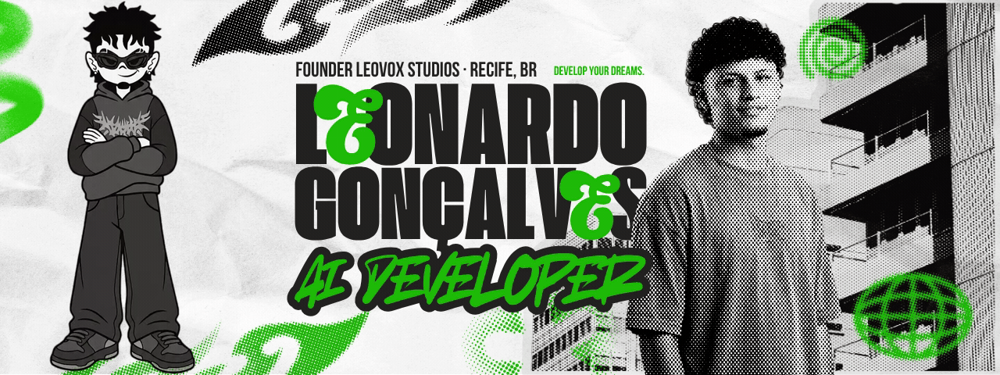
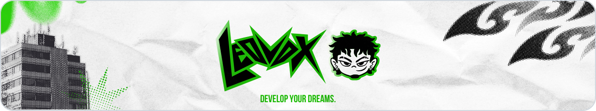

<!-- =================================================================
  README · leozitogs
  Leonardo Gonçalves · Tech Lead & AI Engineer · Founder, Leovox Studios
================================================================= -->

<!-- ===================== HERO ===================== -->

  

<!-- ===================== QUICK LINKS ===================== -->

  
  
  
  

 

<!-- ===================== ABOUT ===================== -->
## 01 · About

**Tech Lead at V-Lab (UFPE)**, the R&D lab of the Center for Informatics, where I lead two AI products and the lab's agentic coding strategy.

My foundation is **AI engineering**. I build multi-agent systems with the Claude Agent SDK and LangGraph, design pipelines with swappable LLMs, and combine them with local specialist models for transcription, risk prediction and hybrid search. Evals measure every outcome.

Two things set me apart:

- **Agentic coding:** building software with AI agents in a team's daily work.
- **Harness engineering:** building the environment that makes that work safe and verifiable, with specs before code, guardrails, human approval gates and automated review.

As a lead, no feature starts without an engineering plan, and decisions live in ADRs. I come from design, run **Leovox Studios**, and study Information Systems at CIn/UFPE.

 

<!-- ===================== NOW ===================== -->
## 02 · What I'm building

**At V-Lab** *(private work, described at a high level)*
- **An ERP built with agentic coding:** about 30 agents on the Claude Agent SDK, orchestrated in LangGraph, with local specialist models, human approval gates and automated review.
- **An AI-powered digital course factory:** a hexagonal TypeScript monorepo with swappable LLMs, versioned prompts, a 7-metric eval and 5,000+ automated tests.

**In the open**
- **[AI Harness Compiler](https://github.com/leozitogs/ai-harness-compiler):** compiles project intent into typed, verifiable AI engineering harnesses.
- **[vid2llm](https://github.com/leozitogs/vid2llm):** turns any video into LLM-ready frames. `pip install vid2llm`

 

<!-- ===================== ARSENAL ===================== -->
## 03 · Arsenal

**AI engineering**  

**ML & specialist models**  

**Agentic coding & harness**  

**Backend**  

**Frontend**  

**Design**  

 

<!-- ===================== SELECTED WORK ===================== -->
## 04 · Selected Work

<table>
<tr>
<td width="50%">

</td>
<td width="50%">

</td>
</tr>
<tr>
<td width="50%">

</td>
<td width="50%">

</td>
</tr>
</table>

 

<!-- ===================== STATS ===================== -->
## 05 · Stats

 

<!-- ===================== LEOVOX ===================== -->
## 06 · Leovox Studios

Leovox is my creative studio, where design meets software: brand identity, web development and product design under one roof. Same standard whether the deliverable is a model, an interface or a brand.

**Develop your dreams.**

<a href="https://www.behance.net/leovoxstudiosS">Behance</a>

 

<!-- ===================== FOOTER ===================== -->

