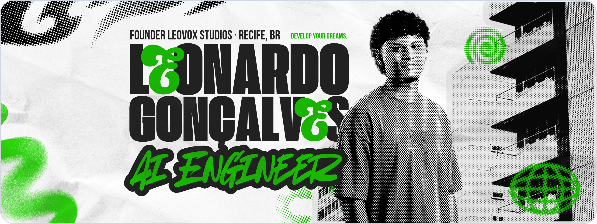
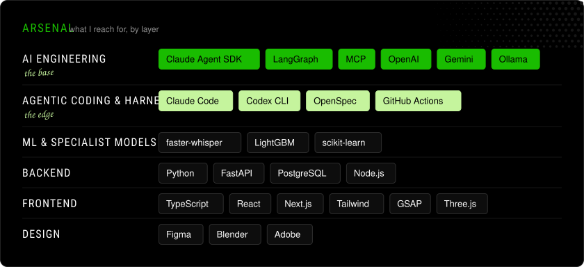
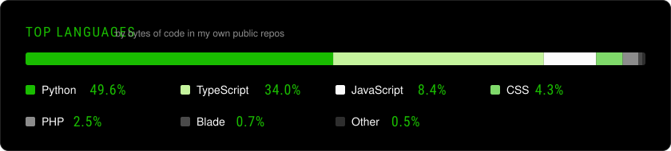

<!-- =================================================================
  README · leozitogs
  Leonardo Gonçalves · AI Engineer · Founder, Leovox Studios
  Cards in assets/cards/ are generated by scripts/build_cards.py
  and refreshed daily by .github/workflows/cards.yml.
================================================================= -->

<!-- ===================== HERO ===================== -->

  <picture>
    <source media="(prefers-color-scheme: dark)" srcset="assets/hero-dark.png">
    <source media="(prefers-color-scheme: light)" srcset="assets/hero.png">
    
  </picture>

<!-- ===================== QUICK LINKS ===================== -->

  
  
  
  

  <b>AI Engineer</b> building multi-agent systems and the harnesses that keep them honest. 
  Tech Lead at V-Lab (UFPE) · Founder of Leovox Studios · Recife, BR

 

<!-- ===================== ABOUT ===================== -->
## 01 · About

I'm an **AI Engineer**, currently **Tech Lead at V-Lab (UFPE)**, the R&D lab of the Center for Informatics, where I lead two AI products and the lab's agentic coding strategy.

My foundation is **AI engineering**: multi-agent systems built with the Claude Agent SDK and LangGraph, pipelines with swappable LLMs, and local specialist models for transcription, risk prediction and hybrid search. Evals measure every outcome.

On top of that base, two things set me apart:

- **Agentic coding:** building software with AI agents as part of a team's daily work.
- **Harness engineering:** building the environment that makes that work safe and verifiable, with specs before code, guardrails, human approval gates and automated review.

As a lead, no feature starts without an engineering plan, and decisions live in ADRs. I come from design, run **Leovox Studios**, and study Information Systems at CIn/UFPE.

 

<!-- ===================== NOW ===================== -->
## 02 · What I'm building

**At V-Lab** *(private work, described at a high level)*
- **An ERP built with agentic coding:** about 30 agents on the Claude Agent SDK, orchestrated in LangGraph, with local specialist models, human approval gates and automated review.
- **An AI-powered digital course factory:** a hexagonal TypeScript monorepo with swappable LLMs, versioned prompts, a 7-metric eval and 5,000+ automated tests.

**In the open**
- **[AI Harness Compiler](https://github.com/leozitogs/ai-harness-compiler):** compiles project intent into typed, verifiable AI engineering harnesses.
- **[vid2llm](https://github.com/leozitogs/vid2llm):** turns any video into LLM-ready frames. `pip install vid2llm`

 

<!-- ===================== SELECTED WORK ===================== -->
## 03 · Selected work

  
  
  
  

 

<!-- ===================== ARSENAL ===================== -->
## 04 · Arsenal

  

 

<!-- ===================== STATS ===================== -->
## 05 · On GitHub

  
  

Built from the GitHub API by <a href="scripts/build_cards.py">scripts/build_cards.py</a> and refreshed every day. No third-party stats service.

 

<!-- ===================== LEOVOX ===================== -->
## 06 · Leovox Studios

Leovox is my creative studio, where design meets software: brand identity, web development and product design under one roof. Same standard whether the deliverable is a model, an interface or a brand.

**Develop your dreams.** See the work on [Behance](https://www.behance.net/leovoxstudiosS).

 

<!-- ===================== FOOTER ===================== -->

  <picture>
    <source media="(prefers-color-scheme: dark)" srcset="assets/footer-dark.png">
    <source media="(prefers-color-scheme: light)" srcset="assets/footer.png">
    
  </picture>

